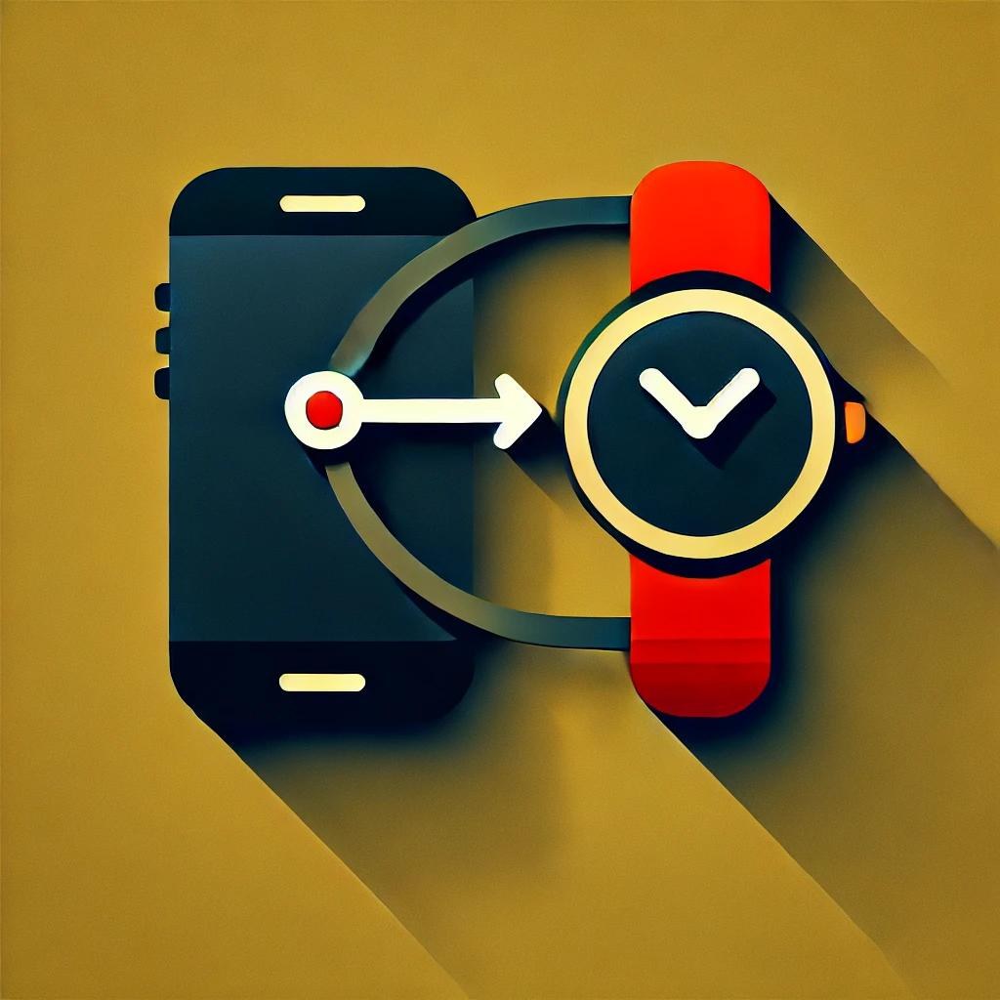
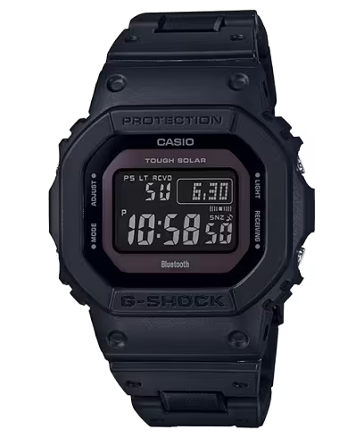
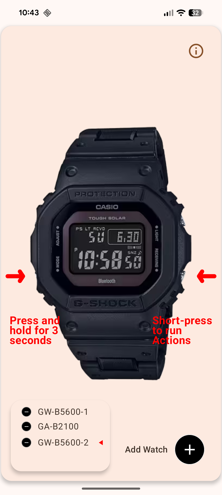
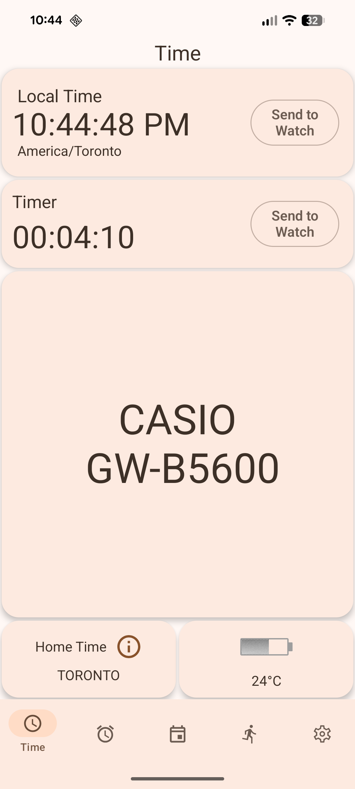
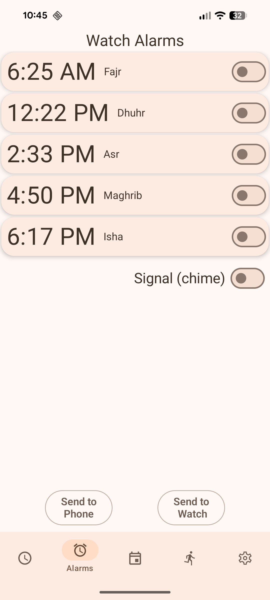
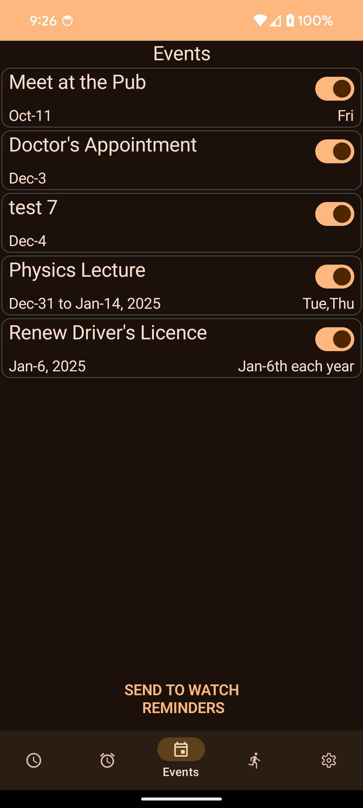
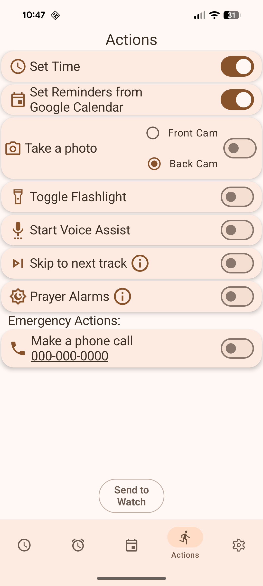
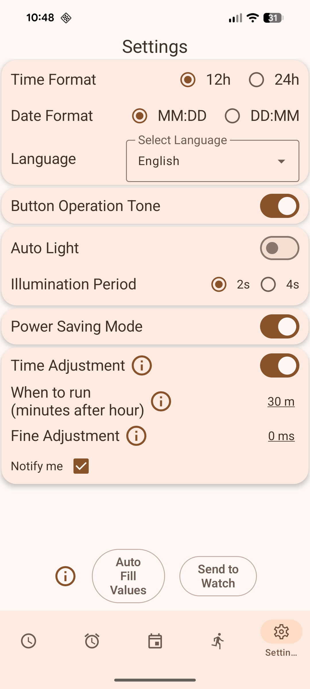

# ABL-100 Music Remote

An experimental Android music remote for the **Casio ABL-100**, based on [izivkov's Casio G-Shock Smart Sync](https://github.com/izivkov/CasioGShockSmartSync). This branch adds an ABL-100-focused music-control interface and watch-button handling. The original project's broader feature descriptions and documentation are retained below for reference; they are **not** claims that this remix has been tested with all those models.

## ⚠️ Experimental — important limitations

This is a hobby project and a fun way to control Android music from a Casio ABL-100, **not a fast or fully reliable replacement for your phone's music controls**.

- **Volume toggle:** In testing on one ABL-100, allow approximately **10–15 seconds between volume commands**. Repeated presses too quickly may seem to do nothing.
- **Bluetooth responsiveness:** Some watch commands may be delayed or inconsistent. The exact behavior may vary by phone and connection conditions.
- **Compatibility:** Tested on the **Casio ABL-100 only**. Other Casio models and Android phones have not been thoroughly tested.

Think of it as a fun experimental mod — more of a party trick than an everyday remote.

## Features of this ABL-100 remix

- **Play/pause from the watch:** hold the **bottom-right** button until the second beep.
- **Next track:** hold the **bottom-left** button until the second beep.
- **Two-level volume toggle:** tap the **bottom-right** button to alternate between your saved *quiet* and *loud* levels.
- **Adjustable volume presets:** set both volume levels with sliders in the Android app. The choices are saved on the phone.
- **Reset controls:** tap the **top-left** button to return to the ready state.
- **Media player selection:** first targets an Android media session that is currently playing; if none is playing, checks for Spotify and then another available media session. Falls back to Android media-button events when needed. Other apps (for example YouTube) may work when they expose a compatible media session.
- **Background button handling:** the app's action listener is initialized at application startup rather than relying on the music screen being open. Actual responsiveness still depends on Android and Bluetooth conditions.
- **Simpler controls screen:** dedicated music controls, clear button instructions, and a new ABL-100 Music Remote name and icon.

### Download and installation tips

1. **Android only:** Download the signed `ABL100-Music-Remote.apk` from the [latest GitHub release](https://github.com/Ricomaker/Casio-ABL-100-Spotify-Remote-Mod/releases/latest). Open the downloaded file and, if Android asks, allow installation from that browser or file manager.
2. **Bluetooth:** Grant the requested Nearby devices/Bluetooth permissions. To initiate a normal watch connection, hold the ABL-100's **lower-left button until the second beep**.
3. **Notification access:** In Android Settings, enable **Notification access** for *ABL-100 Music Remote*. This lets the app find active music sessions, including Spotify and compatible players.
4. **Battery restrictions:** For more reliable background controls, consider setting this app's battery usage to **Unrestricted** or **Don't optimize** (the name and location vary by phone). This can use a little more battery.
5. **If Spotify interferes when entering the watch's settings:** Fully close Spotify before trying to enter the settings on the ABL-100. Pausing Spotify alone may not help because a watch button press can start playback again. Reopen Spotify after you finish in the watch's settings. Check that the app has the requested permissions.
6. **Allow time between commands:** In particular, wait approximately **10–15 seconds between volume-toggle presses** based on testing on one ABL-100. Other commands may also be delayed or inconsistent.

**Updates:** Keep the same app installed and install newer releases over it when available. Do not uninstall just to update unless troubleshooting requires it; uninstalling may erase local settings. The publicly signed remix has its own Android app identity and may install alongside an older/debug build.

### Does the app need to stay open?

**No — you normally do not need to keep the app visible.** The remix initializes its watch-button listener at app startup, allowing music controls to work while the app is minimized or the phone screen is locked, provided Android and Bluetooth keep the connection/background service active.

- **App on screen or minimized:** Controls should work when the watch is connected.
- **Phone locked:** Controls should generally still work.
- **App swiped away:** Behavior varies by Android version and phone manufacturer; background restrictions may interrupt it.
- **App force-stopped:** Controls generally stop until you open the app again.

For better reliability, grant the requested Bluetooth and Notification Access permissions and, if necessary, set the app's battery usage to **Unrestricted** / **Don't optimize** in Android Settings (this may increase battery use). To test, connect the watch, return to your home screen, lock your phone, and try play/pause. Background behavior has not been verified across all Android phones.

### Quick start

1. Install and open this **remix build** (not the upstream release).
2. Connect the ABL-100 using the app. Hold the **lower-left** watch button for approximately 3 seconds to initiate the normal connection, following the watch's beeps.
3. Grant the app the necessary Bluetooth and **Notification Access** permissions for media-session control.
4. Open **Music Remote** to set quiet and loud volume levels, then use the watch button actions above.

**Status and limitations:** This is a personal experimental modification tested with the **ABL-100 only**. Bluetooth triggering can be delayed or inconsistent, and Spotify can interfere when trying to enter the watch's settings; fully closing Spotify first may help, while pausing it alone can allow watch commands to restart playback. The modified source is on the `abl100-local-backup` branch and UI refinements on `ui/abl100-clear-controls-branding`. A signed APK is available as [v1.0.0](https://github.com/Ricomaker/Casio-ABL-100-Spotify-Remote-Mod/releases/tag/v1.0.0), tested by the maintainer on their own ABL-100; other phones and watch models are not yet broadly verified. Other Casio models are not verified for the remix.

**Credit and license:** Based on the original work by **izivkov**. Keep the upstream attribution, LICENSE file and license notices when redistributing. This is an unofficial community modification, not a Casio or Spotify product.

---

## Original project documentation (upstream reference)

# Casio G-Shock Smart Sync

<p align="center">
  
</p>

[](https://f-droid.org/en/packages/org.avmedia.gshockGoogleSync/)
[](https://github.com/izivkov/CasioGShockSmartSync)
[](https://github.com/izivkov/CasioGShockSmartSync/releases)
[](#)

**G-Shock Smart Sync** is an unofficial, open-source Android app for G-Shock, Edifice, and Pro Trek watches. It allows you to control your watch, sync data, and configure settings **without a Casio ID**.

It offers a faster, privacy-focused, and more powerful alternative to the official Casio app.

---

## Key Features

- **No Account Required**: Skip the Casio ID login entirely.
- **Calendar Sync**: Push your calendar events (Google, Samsung, etc.) to your watch as reminders.
- **Auto Timezone**: Automatically adjusts watch time when you travel.
- **Remote Control**: Use your watch buttons to take photos, control music, or launch voice assistants.
- **Alarm Sync**: Configure watch alarms easily from your phone.
- **Phone Finder**: Trigger a loud alarm on your phone to find it.

---

## Supported Watch Models

The app works with many Bluetooth-enabled G-Shock, Edifice, and Pro Trek models.

<p align="center">
  
  
  
  
</p>

| Series | Compatible Models (Examples) | Note |
|:---|:---|:---|
| **Square** | GW-B5600, GMW-B5000, GW-B5000, DW-B5600, TRN-50 | Classic square design support |
| **CasiOak** | GA-B2100, GBM-2100, GMC-B2100, MRG-B2100 | Octagonal bezel models |
| **G-Steel** | GST-B100 to B1000, GST-W1000, ECB-900 | Metal series |
| **Edifice** | ECB-10 to ECB-2300, EQB-500 to EQB-2000 | Bluetooth Edifice series |
| **MT-G / MR-G** | MTG-B1000/B3000/B3100, MRG-B5000/B2100 | Premium metal and carbon models |
| **Others** | ABL-100WE, GBD-100/200, GBD-H1000/H2000, GPR-B1000 | Step trackers, GPS, and sensors |

> **Note**: While these watches connect, not all specific hardware features (like fitness tracking steps on GBD models) may be fully supported yet.

---

## App Walkthrough

Here is a guide to the main screens of the application.

### 1. Connection Screen



This is the first screen you see. It handles the Bluetooth connection to your watch.

- **Status**: Shows generic connection status.
- **Scan/Connect**: Automatically scans for your watch.
- **Paired Devices**: Lists your previously connected watches for quick access.

The app communicates directly with the watch via BLE. Connection is typically much faster than the official app (~3.5s vs 12s).

<br clear="all"/>

### 2. Time Setting



Manage your watch's timekeeping effortlessly.

- **Local Time**: Displays the current time from your phone.
- **Send to Watch**: Tap the button to sync your phone's time, timezone, and DST settings to the watch immediately.
- **Home Time**: Shows the 'Home' city configured on the watch.
- **Battery**: Displays the current battery level of the watch (e.g., High, Medium, Low).

<br clear="all"/>

### 3. Alarms



Read and configure the alarms stored on your watch.

- **View Alarms**: See the current settings for all 5 alarms and the hourly signal (Chime).
- **Edit**: Tap any alarm to change its time.
- **Sync**: You can send these alarm settings to the watch. 

*Note: Due to Android limitations, we cannot read alarms set in your phone's native Clock app, but we can set the watch's internal alarms.*

<br clear="all"/>

### 4. Events (Calendar Sync)



Sync your Android calendars to your watch!

- **Upcoming Events**: Lists future events from your phone's calendars.
- **Send to Watch**: Pushes these events to the watch's Reminder feature.
- **Compatibility**: Supports standard Android calendar events. Complex recurrence rules might show as "Incompatible".

The watch will display these as reminders with the date and title.

<br clear="all"/>

### 5. Actions (Remote Control)



Turn your watch into a remote control. Assign actions to button presses on the watch.

- **Available Actions**:
  - **Find Phone**: Make your phone ring loudly.
  - **Take Photo**: Snap a picture with your phone's camera.
  - **Flashlight**: Turn on your phone's flashlight.
  - **Next Track**: Skip music tracks on your phone.
  - **Voice Assist**: Launch Google Assistant.
  - **Set Prayer Alarms**: Set the watch's 5 alarms to Islamic Prayer Times
- **How to use**: Short-press the lower-right button on the watch (when in Time mode) to trigger the selected action.

*Note*: The **Take Photo** action requires the app to be in the foreground. If the app is in the background, the action will not work.

<br clear="all"/>

### 6. Settings



Configure app and watch preferences.

- **Watch Settings**: Adjust specific watch configurations (light duration, power saving, etc.).
- **App Settings**: Configure theme, behavior, and advanced options.

<br clear="all"/>

---

## Installation

- **F-Droid**: [Download here](https://f-droid.org/en/packages/org.avmedia.gshockGoogleSync/)
- **GitHub**: [Download APK from Releases](https://github.com/izivkov/CasioGShockSmartSync/releases/)

## Contributing

We welcome contributions!
- **Code**: Submit a PR to add features or fix bugs.
- **Watches**: If you have a G-Shock model not yet supported, functionality can often be added. Donations of test units are also highly appreciated to help expand compatibility.

## Related Projects

| Project | Description |
|:---|:---|
| [**GShockAPI**](https://github.com/izivkov/GShockAPI) | The core Android library that **this app is built on**. It encapsulates all low-level Bluetooth communication and watch protocol logic (time sync, alarms, reminders, DST, etc.) into a clean Kotlin API. This project consumes it as a direct dependency via `implementation(libs.gshockapi)`. You can also use it independently to **build your own G-Shock Android app**. |
| [**G-Shock Time Server**](https://github.com/izivkov/GShockTimeServer) | A Python script that acts as a headless time server, automatically syncing the time on G-Shock watches over Bluetooth — ideal for Raspberry Pi or other always-on Linux devices. |
| [**G-Shock API for ESP32**](https://github.com/izivkov/gshock-api-esp32) | A MicroPython firmware that turns a low-cost ESP32 microcontroller (with optional touch LCD display) into a standalone, always-on G-Shock time server — no phone or PC required. Watches connect automatically up to four times a day, or on-demand via a button press. |
| [**G-Shock Smart Sync Webapp**](https://github.com/izivkov/gshock-smart-sync-webapp) | Is an experimental, web-based app that provides G-Shock watch synchronization from a browser, enabling time sync, alarms, reminders, and remote control via Web Bluetooth — no Android required. |
| [**gshock_api**](https://github.com/izivkov/gshock_api) | A **Python API library** for G-Shock watches, featuring a pure functional architecture. It supports a wide range of models and provides a clean interface for time sync, settings, and notifications via BLE. |

---

## For Developers

### Capturing BLE Messages with Wireshark

Wireshark can be used to inspect the raw Bluetooth Low Energy (BLE) packets exchanged between your Android phone and the G-Shock watch. This is useful for reverse-engineering watch protocols or debugging communication issues.

#### 1. Phone Setup (Enable HCI Snoop Log)

Android has a built-in BLE packet logger. Enable it via Developer Options:

1. Go to **Settings → About Phone** and tap **Build Number** 7 times to enable Developer Options.
2. Go to **Settings → Developer Options**.
3. Enable **Bluetooth HCI Snoop Log** (exact label varies by device/Android version).
4. **Restart Bluetooth** (toggle it off and on) to start logging.
5. Reproduce the action you want to capture (e.g., connect the app to the watch and sync time).
6. Disable the snoop log again, then pull the log file from the device:

```bash
adb bugreport bugreport.zip
```

The HCI log is embedded in the bugreport. Alternatively, on many devices it is available directly at:

```bash
adb pull /sdcard/btsnoop_hci.log
```

> **Tip**: The exact path may differ. Search inside the bugreport ZIP for a file named `btsnoop_hci.log`.

#### 2. Install Wireshark

```bash
# Ubuntu / Debian
sudo apt install wireshark

# macOS (Homebrew)
brew install --cask wireshark
```

Or download the installer from [wireshark.org](https://www.wireshark.org/download.html).

#### 3. Open and Filter the Log

1. Open Wireshark and go to **File → Open**, then select `btsnoop_hci.log`.
2. Wireshark will decode the BLE packets automatically.
3. Use display filters to focus on relevant traffic:

| Goal | Filter |
|:---|:---|
| All BLE ATT traffic | `btatt` |
| Specific device by address | `bluetooth.addr == AA:BB:CC:DD:EE:FF` |
| ATT write operations | `btatt.opcode == 0x12` |
| ATT notifications | `btatt.opcode == 0x1b` |

4. Right-click a packet → **Follow → Bluetooth ATT Stream** to trace a full conversation.
5. The **Packet Bytes** pane at the bottom shows the raw hex payload sent to/from the watch.

---

## License

This project is licensed under the MIT License - see the LICENSE file for details.
